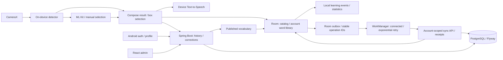

# LingoLens

**Learn English from your surroundings with on-device object recognition.**

[](https://github.com/TrinhQuocDat542005/LingoLens/actions/workflows/ci.yml)

LingoLens combines a Kotlin Android app, a Spring Boot API and a React admin console. Capture everyday objects, select a detected bounding box and explore English vocabulary. Images are processed on the phone and are not uploaded to the API.

## Implemented features

- CameraX capture, EXIF orientation handling and image downsampling.
- Bundled EfficientDet-Lite0 INT8 detection, selectable boxes, confidence and inference timing.
- Image quality warnings, ML Kit Image Labeling fallback and manual word selection.
- Registration/login, encrypted Android session storage, hashed/rotating refresh tokens and role-based access.
- Room-backed word library isolated by account, durable learning events and local progress statistics.
- Durable outbox for save/delete, recognition history and corrections; WorkManager retries when connected.
- Idempotent server receipts, account fencing, cloud library restoration and visible pending/error status.
- Published vocabulary API, transactional catalog cache refresh and offline access to downloaded/saved content.
- Real device Text-to-Speech with language availability checks and lifecycle cleanup.
- Recognition history and correction reports synchronized to the API.
- Admin console for user status/roles, vocabulary publishing, correction review and audit logs.
- Flyway migrations, API/unit tests, PostgreSQL integration tests and CI build artifacts.

**Current limits:** Learning data synchronizes with the account through a durable local queue; spaced repetition is planned. Conflicting edits from different devices use server arrival order (last accepted save/delete wins). First login and first content download require the API. A previously signed-in account can reopen using its cached profile during a network outage; offline access cannot detect server-side account revocation until reconnection. TTS depends on an installed English voice and the engine may require a network connection. Model accuracy has not yet been measured; see the [evaluation protocol](docs/model-evaluation/README.md).

## Try the learning loop

1. Start the API and admin console, then install the Android debug APK.
2. Register a learner. Home starts with an empty library and zero activity.
3. Capture a supported object (for example, a book), choose a detection and open its published vocabulary.
4. Play the English pronunciation, save the word and check My Words / Stats and the sync status card.
5. Reopen the app: the saved word remains. Switch accounts: each account has its own library.
6. After Home downloads the catalog, disconnect the network and save/delete words or queue a correction. Reconnect: the pending count drains automatically; **Sync / retry** also requests a run.
7. Sign in with the same account on another installation and sync to restore the saved library and first-learning history.
8. Edit/publish vocabulary in the admin console, use **Refresh content** on the result screen and see the revised content.

On-device processing keeps captured images off the server. Saved snapshots contain vocabulary text; temporary image paths are not persisted in the library.

## Architecture



| Part | Stack | Directory |
| --- | --- | --- |
| Android | Kotlin, Compose, CameraX, MediaPipe, ML Kit, Retrofit, Room, DataStore, Keystore, TTS | `app/` |
| API | Kotlin, Spring Boot/Security, JWT, JPA, Flyway, OpenAPI | `backend/` |
| Admin | React, TypeScript, Vite | `admin-dashboard/` |
| Database | PostgreSQL 15 | `docker-compose.yml` |

See [architecture and decisions](docs/architecture.md) for data boundaries and tradeoffs.

## Prerequisites

- Docker Desktop with the Linux engine running, or Docker Engine + Compose on Linux.
- Android Studio supporting AGP 9.3, JDK **21**, SDK platform **36.1** and Build Tools **36.0.0** for Android.
- Node.js **24** and npm for admin.
- JDK 21 for running/testing the API outside Docker. Gradle wrappers are included.

## Quick start

```powershell
git clone https://github.com/TrinhQuocDat542005/LingoLens.git
cd LingoLens
Copy-Item .env.example .env
```

On Linux/macOS use `cp .env.example .env`. Example credentials are for local development. Set both `ADMIN_EMAIL` and `ADMIN_PASSWORD` in `.env` to provision an admin; the password must contain at least 12 characters. Use unquoted `KEY=value` values because the development API reads this file as Java properties.

### API and database

```powershell
docker compose up --build -d
docker compose logs -f backend
```

The first build downloads dependencies. PostgreSQL becomes healthy before the API starts; Flyway applies migrations and vocabulary seed data.

- API: <http://localhost:8080>
- Health: <http://localhost:8080/actuator/health>
- Swagger: <http://localhost:8080/swagger-ui.html>
- Database from the host: `localhost:5433`, database `lingolens`.

Stop with `docker compose down`; the database volume remains. Changing `.env` credentials does not change passwords in an already initialized database volume.

### Admin console

```powershell
cd admin-dashboard
npm ci
npm run dev
```

Open <http://localhost:5173> and use the configured admin credentials. For another API, copy `admin-dashboard/.env.example` to `admin-dashboard/.env`, set `VITE_API_BASE_URL` and restart Vite. Add the console origin to the backend's `CORS_ALLOWED_ORIGINS`.

Admin bootstrap creates or updates the account's password, roles and enabled status at every API startup while both credentials are configured. Remove those variables and restart after provisioning if you do not want that repeated behavior.

### Android

Open the root project in Android Studio, select JDK 21 for Gradle and install the SDK packages above. Debug defaults to `http://10.0.2.2:8080/` for the emulator.

```powershell
.\gradlew.bat assembleDebug
```

APK: `app/build/outputs/apk/debug/app-debug.apk`. Run through Android Studio or install with `adb install -r app/build/outputs/apk/debug/app-debug.apk`.

For a physical device on the same network, replace `YOUR_LAN_IP` with the computer's address:

```powershell
.\gradlew.bat assembleDebug -PapiBaseUrl=http://YOUR_LAN_IP:8080/
```

Alternatively set `LINGOLENS_API_BASE_URL`, or put `apiBaseUrl=...` in user Gradle properties for Android Studio. Gradle properties take precedence over environment values. HTTP is permitted only in debug.

Release requires an explicit HTTPS endpoint; replace `YOUR_API_HOST` with the deployed host:

```powershell
.\gradlew.bat assembleRelease -PreleaseApiBaseUrl=https://YOUR_API_HOST/
```

Alternatively set `LINGOLENS_RELEASE_API_BASE_URL`. Signing must be configured privately; the project does not contain release signing credentials. Main/release network configuration rejects HTTP.

### API without the backend container

Start just the database with `docker compose up -d postgres`. Stop the Compose backend first to avoid a port conflict, then:

```powershell
cd backend
.\gradlew.bat bootRun
```

Default profile `dev` reads the repository `.env` from this working directory. Environment variables override file values. `prod` does not import `.env`: supply `DB_URL`, `DB_USERNAME`, `DB_PASSWORD`, `JWT_SECRET` and `CORS_ALLOWED_ORIGINS` in the deployment environment. JWT keys need at least 32 UTF-8 bytes. Serve the deployed API through HTTPS.

## Verification

From the repository root:

```powershell
.\gradlew.bat testDebugUnitTest lintDebug assembleDebug
.\backend\gradlew.bat -p backend test bootJar
.\backend\gradlew.bat -p backend postgresTest
cd admin-dashboard
npm ci
npm run build
```

`test` uses H2 without Docker. `postgresTest` requires Docker and checks migrations, seed content and recognition/report ownership against a disposable PostgreSQL container. On Linux/macOS use `bash ./gradlew ...` or `bash backend/gradlew -p backend ...`.

[CI](.github/workflows/ci.yml) covers Android tests/lint/build, backend H2/PostgreSQL tests/packaging, admin build and Compose API startup. Reports, debug APK and admin output are workflow artifacts. Camera behavior and model accuracy remain physical-device checks.

## Data and offline behavior

| Data | Owner / storage | Offline behavior |
| --- | --- | --- |
| Published vocabulary | API / PostgreSQL, shared Room cache | Read after download; manual refresh checks latest publication |
| Saved words | Account ID + normalized word / Room and PostgreSQL | Save/delete locally; durable queue uploads, cloud snapshot restores other installations |
| Learning events | First save per account and word / Room and PostgreSQL | Drive daily counts, 7-day activity and streak; merge earliest first-save date |
| Session | Keystore-encrypted tokens + cached profile / DataStore | Cached profile only on connection failure; rejected credentials do not restore it |
| Recognition history / corrections | Room outbox → API / PostgreSQL | Queue without a connection; corrections depend on their recognition operation |

A word is counted as newly learned only on its first save for that account. Deleting a word removes it from the library while retaining its first learning event; resaving does not inflate progress. Streak counts consecutive active local calendar days, allowing an unfinished current day. Vocabulary refresh downloads every page before replacing the cache in one transaction. A lookup returning `404` evicts the shared cache entry; an existing personal saved snapshot remains accessible with a notice. Account data and tokens are excluded from Android backup/device transfer.

### Published vocabulary endpoints

Bearer authentication is required. Drafts are excluded from both endpoints.

```http
GET /api/v1/vocabularies?search=book&page=0&size=50
GET /api/v1/vocabularies/book
```

The catalog returns `data.content` and `data.totalPages`; size is bounded to 1–100. Lookup matches case-insensitively and returns a structured `404 / VOCABULARY_NOT_FOUND` for absent or unpublished words. Unknown words do not receive fabricated definitions, translations or phonetics.

### Durable sync

Local edits and their upload intent commit together in Room. Connected WorkManager jobs process each account's queue in order with exponential backoff; periodic work and startup recovery cover an interrupted enqueue. Successful server acknowledgement removes an operation. Transport failures / HTTP 408, 429 and 5xx retry; authentication failure pauses; other rejected operations remain visible and block the queue until manual retry. The UI distinguishes **queued locally** from a server acknowledgement.

```http
POST /api/v1/sync/operations
GET /api/v1/sync/learning?accountId=123
```

Every operation carries a stable UUID and expected account ID. The server checks that account against the authenticated user, locks account writes, and commits the operation plus its receipt atomically. A replay returns the original receipt; reusing an ID with different content returns `409`. Old replays cannot resurrect words deleted by later operations. Corrections reference the UUID of their recognition, so both can be queued offline.

Cloud pull uses a full account snapshot after draining the queue, preserving local edits made while the download was in flight. Tombstones retain deletion and first-learning history. WorkManager execution timing depends on Android scheduling; it is not an exact timer. See the [sync protocol and conflict policy](docs/sync-protocol.md).

## Model provenance

The bundled EfficientDet-Lite0 INT8 model is pretrained for COCO and used through MediaPipe Tasks Vision. It is not trained specifically for LingoLens.

- Tracked asset: `app/src/main/assets/efficientdet_lite0.tflite`.
- SHA-256: `0720bf247bd76e6594ea28fa9c6f7c5242be774818997dbbeffc4da460c723bb` (checked by CI).
- Protocol and targets: [model evaluation](docs/model-evaluation/README.md).
- Upstream: [Google MediaPipe Android guide](https://developers.google.com/edge/mediapipe/solutions/vision/object_detector/android).

## Milestones

1. Reproducible setup, auth fixes, CI and documentation — [week 1 report](docs/portfolio/week1.md).
2. Persistent words per account, vocabulary API/cache, local learning statistics and real Text-to-Speech — [week 2 report](docs/portfolio/week2.md).
3. Offline write queue, retry, idempotent sync and cloud library restoration — [week 3 report](docs/portfolio/week3.md).
4. Spaced repetition, review scheduling and retention statistics.
5. Physical-device benchmarks, demo video and release.
