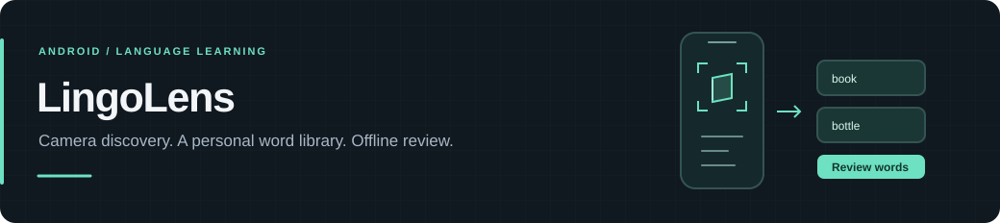

<h1></h1>

Ứng dụng Android để nhận diện đồ vật qua camera, lưu từ vựng và ôn tập khi không có mạng. Dự án gồm app Kotlin, API Spring Boot và trang quản trị React.

[](https://github.com/TrinhQuocDat542005/LingoLens/actions/workflows/ci.yml)


[Chạy thử](#chạy-thử) · [Luồng sử dụng](#luồng-sử-dụng) · [Kiến trúc](docs/architecture.md) · [Hướng dẫn phát triển](docs/DEVELOPMENT.md)

## Luồng sử dụng

**Chụp đồ vật → chọn kết quả → nghe phát âm → lưu từ → ôn tập.**

Ảnh được xử lý ngay trên điện thoại. Kết quả nhận diện mở từ vựng tương ứng; người học có thể nghe phát âm, lưu vào sổ tay và dùng flashcard để ôn lại. Nếu mô hình không nhận ra đồ vật, app có nhãn gợi ý và lựa chọn thủ công.

| Phần | Cách hoạt động |
| :--- | :--- |
| Camera | CameraX, EfficientDet-Lite0 và ML Kit; hiển thị vùng nhận diện và độ tin cậy |
| Sổ từ vựng | Lưu theo tài khoản bằng Room; có trạng thái chờ đồng bộ và thử lại |
| Ôn tập | Flashcard với bốn mức đánh giá; lưu phiên để tiếp tục sau khi đóng app |
| Bài học | Tải trọn chặng ba bài, làm bài offline và gửi kết quả để server xác nhận XP |
| Quản trị | Quản lý từ vựng, quyền tài khoản và báo cáo sửa kết quả nhận diện |

**Phạm vi:** đây là dự án portfolio, chưa phát hành trên Google Play. Bài học dùng nội dung DEMO để thử phần mềm, chưa phải giáo trình đã được thẩm định. Chưa có số đo độ chính xác camera trên thiết bị tham chiếu.

## Chạy thử

Cần Docker với Linux containers, JDK **21**, Node.js **24** và Android Studio có SDK **36.1**. Xem [cấu hình đầy đủ](docs/DEVELOPMENT.md#prerequisites) nếu chạy lần đầu.

### 1. API và database

```powershell
git clone https://github.com/TrinhQuocDat542005/LingoLens.git
cd LingoLens
Copy-Item .env.example .env
docker compose up --build -d
```

Trên Linux/macOS, thay `Copy-Item` bằng `cp`. Điền `ADMIN_EMAIL` và `ADMIN_PASSWORD` trong `.env` nếu cần tài khoản quản trị; mật khẩu tối thiểu 12 ký tự. Giá trị mẫu chỉ dành cho development.

API ở [localhost:8080](http://localhost:8080), tài liệu API ở [Swagger UI](http://localhost:8080/swagger-ui.html).

### 2. Trang quản trị

Mở terminal khác tại thư mục gốc:

```powershell
cd admin-dashboard
npm ci
npm run dev
```

Truy cập [localhost:5173](http://localhost:5173). Xem [cấu hình admin](docs/DEVELOPMENT.md#admin-console) để đổi API hoặc quản lý tài khoản bootstrap.

### 3. Android

Mở repository trong Android Studio, chọn JDK 21 rồi chạy app trên emulator. Hoặc build tại thư mục gốc:

```powershell
.\gradlew.bat assembleDebug
```

APK nằm tại `app/build/outputs/apk/debug/app-debug.apk`. Emulator dùng API `http://10.0.2.2:8080/`; [hướng dẫn Android](docs/DEVELOPMENT.md#android) có cấu hình cho điện thoại thật và release.

## Thiết kế kỹ thuật

| Thành phần | Công nghệ | Mã nguồn |
| :--- | :--- | :--- |
| Android | Kotlin, Jetpack Compose, CameraX, Room, WorkManager | [`app/`](app/) |
| Backend | Kotlin, Spring Boot, Spring Security, JPA, Flyway | [`backend/`](backend/) |
| Admin | React, TypeScript, Vite | [`admin-dashboard/`](admin-dashboard/) |
| Database | PostgreSQL | [`docker-compose.yml`](docker-compose.yml) |
| Logic dùng chung | Chấm bài và lịch ôn tập bằng Kotlin | [`shared/`](shared/) |

App ghi dữ liệu và yêu cầu đồng bộ vào Room cùng một transaction. WorkManager gửi lại khi có mạng; API dùng ID thao tác để xử lý việc gửi lặp. Tiến độ bài học offline là tạm thời, XP chính thức đến từ server.

[Kiến trúc và quyết định](docs/architecture.md) · [Đồng bộ và xung đột](docs/sync-protocol.md) · [Lịch ôn tập](docs/spaced-review.md)

## Kiểm thử và giới hạn

[CI](https://github.com/TrinhQuocDat542005/LingoLens/actions/workflows/ci.yml) chạy test Android, backend, PostgreSQL, lint và build. Lệnh chạy lại nằm trong [development reference](docs/DEVELOPMENT.md#verification).

- Đăng nhập lần đầu và tải nội dung lần đầu cần API; nội dung đã tải có thể dùng offline.
- Lịch ôn tập là thuật toán riêng. Chưa có nghiên cứu đo mức cải thiện ghi nhớ; số liệu tự đánh giá không phải điểm năng lực tiếng Anh.
- TTS phụ thuộc voice/engine trên thiết bị. Camera, vòng đời app, nâng cấp APK và WorkManager cần kiểm chứng trên thiết bị, ngoài test tự động.
- Mô hình nhận diện là EfficientDet-Lite0 pretrained trên COCO. [Giao thức đánh giá](docs/model-evaluation/README.md) ghi mục tiêu cần đo, không phải kết quả đã đạt.

<details>
<summary>Tài liệu nghiệm thu và lịch sử phát triển</summary>

[Offline lessons](docs/portfolio/week6-step7.md) · [Các kiểu câu hỏi và TTS](docs/portfolio/week7-step3.md) · [Analytics](docs/product/week8-analytics-android.md) · [Camera–chủ đề](docs/portfolio/camera-topic.md) · [Xóa tài khoản](docs/portfolio/account-deletion.md)

Các báo cáo lưu trạng thái và số đo tại thời điểm viết; ghi chú về nhánh trong báo cáo có thể thuộc lịch sử trước khi gộp vào `main`. Xem mã nguồn và CI của revision đang dùng để đối chiếu.

</details>

<sub>Dự án có sử dụng AI hỗ trợ lập kế hoạch, viết mã và soạn bản nháp tài liệu. Kết quả test và những phần chưa kiểm chứng được ghi riêng trong các báo cáo.</sub>
