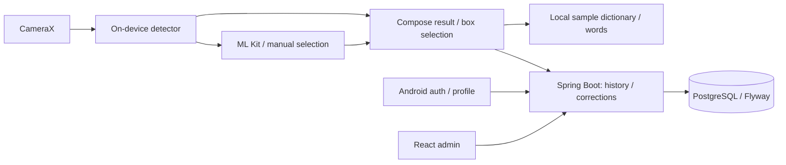

# LingoLens

**Learn English from your surroundings with on-device object recognition.**

[](https://github.com/TrinhQuocDat542005/LingoLens/actions/workflows/ci.yml)

LingoLens combines a Kotlin Android app, a Spring Boot API and a React admin console. Capture everyday objects, select a detected bounding box and explore English vocabulary. Images are processed on the phone and are not uploaded to the API.

## Implemented features

- CameraX capture, EXIF orientation handling and image downsampling.
- Bundled EfficientDet-Lite0 INT8 detection, selectable boxes, confidence and inference timing.
- Image quality warnings, ML Kit Image Labeling fallback and manual word selection.
- Registration/login, encrypted Android session storage, hashed/rotating refresh tokens and role-based access.
- Recognition history and correction reports synchronized to the API.
- Admin console for user status/roles, vocabulary publishing, correction review and audit logs.
- Flyway migrations, API/unit tests, PostgreSQL integration tests and CI build artifacts.

**Current limits:** My Words and learning statistics use an in-memory sample repository. Dictionary content is local/sample content; pronunciation is a placeholder. Recognition works offline, but session restoration and history sync require the API. Persistent learning, background sync, real pronunciation and spaced repetition are next milestones. Device model accuracy has not yet been measured; see the [evaluation protocol](docs/model-evaluation/README.md).

## Architecture



| Part | Stack | Directory |
| --- | --- | --- |
| Android | Kotlin, Compose, CameraX, MediaPipe, ML Kit, Retrofit, DataStore, Keystore | `app/` |
| API | Kotlin, Spring Boot/Security, JWT, JPA, Flyway, OpenAPI | `backend/` |
| Admin | React, TypeScript, Vite | `admin-dashboard/` |
| Database | PostgreSQL 15 | `docker-compose.yml` |

See [architecture and decisions](docs/architecture.md) for data boundaries and tradeoffs.

## Prerequisites

- Docker Desktop with the Linux engine running, or Docker Engine + Compose on Linux.
- Android Studio supporting AGP 9.3, JDK **21**, SDK platform **36.1** and Build Tools **36.0.0** for Android.
- Node.js **24** and npm for admin.
- JDK 21 for running/testing the API outside Docker. Gradle wrappers are included.

## Quick start

```powershell
git clone https://github.com/TrinhQuocDat542005/LingoLens.git
cd LingoLens
Copy-Item .env.example .env
```

On Linux/macOS use `cp .env.example .env`. Example credentials are for local development. Set both `ADMIN_EMAIL` and `ADMIN_PASSWORD` in `.env` to provision an admin; the password must contain at least 12 characters. Use unquoted `KEY=value` values because the development API reads this file as Java properties.

### API and database

```powershell
docker compose up --build -d
docker compose logs -f backend
```

The first build downloads dependencies. PostgreSQL becomes healthy before the API starts; Flyway applies migrations and vocabulary seed data.

- API: <http://localhost:8080>
- Health: <http://localhost:8080/actuator/health>
- Swagger: <http://localhost:8080/swagger-ui.html>
- Database from the host: `localhost:5433`, database `lingolens`.

Stop with `docker compose down`; the database volume remains. Changing `.env` credentials does not change passwords in an already initialized database volume.

### Admin console

```powershell
cd admin-dashboard
npm ci
npm run dev
```

Open <http://localhost:5173> and use the configured admin credentials. For another API, copy `admin-dashboard/.env.example` to `admin-dashboard/.env`, set `VITE_API_BASE_URL` and restart Vite. Add the console origin to the backend's `CORS_ALLOWED_ORIGINS`.

Admin bootstrap creates or updates the account's password, roles and enabled status at every API startup while both credentials are configured. Remove those variables and restart after provisioning if you do not want that repeated behavior.

### Android

Open the root project in Android Studio, select JDK 21 for Gradle and install the SDK packages above. Debug defaults to `http://10.0.2.2:8080/` for the emulator.

```powershell
.\gradlew.bat assembleDebug
```

APK: `app/build/outputs/apk/debug/app-debug.apk`. Run through Android Studio or install with `adb install -r app/build/outputs/apk/debug/app-debug.apk`.

For a physical device on the same network, replace `YOUR_LAN_IP` with the computer's address:

```powershell
.\gradlew.bat assembleDebug -PapiBaseUrl=http://YOUR_LAN_IP:8080/
```

Alternatively set `LINGOLENS_API_BASE_URL`, or put `apiBaseUrl=...` in user Gradle properties for Android Studio. Gradle properties take precedence over environment values. HTTP is permitted only in debug.

Release requires an explicit HTTPS endpoint; replace `YOUR_API_HOST` with the deployed host:

```powershell
.\gradlew.bat assembleRelease -PreleaseApiBaseUrl=https://YOUR_API_HOST/
```

Alternatively set `LINGOLENS_RELEASE_API_BASE_URL`. Signing must be configured privately; the project does not contain release signing credentials. Main/release network configuration rejects HTTP.

### API without the backend container

Start just the database with `docker compose up -d postgres`. Stop the Compose backend first to avoid a port conflict, then:

```powershell
cd backend
.\gradlew.bat bootRun
```

Default profile `dev` reads the repository `.env` from this working directory. Environment variables override file values. `prod` does not import `.env`: supply `DB_URL`, `DB_USERNAME`, `DB_PASSWORD`, `JWT_SECRET` and `CORS_ALLOWED_ORIGINS` in the deployment environment. JWT keys need at least 32 UTF-8 bytes. Serve the deployed API through HTTPS.

## Verification

From the repository root:

```powershell
.\gradlew.bat testDebugUnitTest lintDebug assembleDebug
.\backend\gradlew.bat -p backend test bootJar
.\backend\gradlew.bat -p backend postgresTest
cd admin-dashboard
npm ci
npm run build
```

`test` uses H2 without Docker. `postgresTest` requires Docker and checks migrations, seed content and recognition/report ownership against a disposable PostgreSQL container. On Linux/macOS use `bash ./gradlew ...` or `bash backend/gradlew -p backend ...`.

[CI](.github/workflows/ci.yml) covers Android tests/lint/build, backend H2/PostgreSQL tests/packaging, admin build and Compose API startup. Reports, debug APK and admin output are workflow artifacts. Camera behavior and model accuracy remain physical-device checks.

## Model provenance

The bundled EfficientDet-Lite0 INT8 model is pretrained for COCO and used through MediaPipe Tasks Vision. It is not trained specifically for LingoLens.

- Tracked asset: `app/src/main/assets/efficientdet_lite0.tflite`.
- SHA-256: `0720bf247bd76e6594ea28fa9c6f7c5242be774818997dbbeffc4da460c723bb` (checked by CI).
- Protocol and targets: [model evaluation](docs/model-evaluation/README.md).
- Upstream: [Google MediaPipe Android guide](https://developers.google.com/edge/mediapipe/solutions/vision/object_detector/android).

## Milestones

1. Reproducible setup, auth fixes, CI and documentation — [week 1 report](docs/portfolio/week1.md).
2. Persistent words per account, vocabulary API/cache and real Text-to-Speech.
3. Offline write queue, retry and idempotent sync.
4. Spaced repetition and real progress statistics.
5. Physical-device benchmarks, demo video and release.
