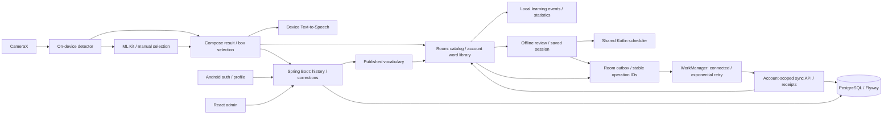

# Development reference

[← LingoLens](../README.md)

Cấu hình, lệnh build và cơ chế dữ liệu chi tiết. Các báo cáo theo tuần trong `docs/portfolio/` lưu kết quả của từng thời điểm.

## Architecture



| Part | Stack | Directory |
| --- | --- | --- |
| Android | Kotlin, Compose, CameraX, MediaPipe, ML Kit, Retrofit, Room, DataStore, Keystore, TTS | `app/` |
| API | Kotlin, Spring Boot/Security, JWT, JPA, Flyway, OpenAPI | `backend/` |
| Admin | React, TypeScript, Vite | `admin-dashboard/` |
| Database | PostgreSQL 15 | `docker-compose.yml` |

See [architecture and decisions](../docs/architecture.md) for data boundaries and tradeoffs.

## Prerequisites

- Docker Desktop with the Linux engine running, or Docker Engine + Compose on Linux.
- Android Studio supporting AGP 9.3, JDK **21**, SDK platform **36.1** and Build Tools **36.0.0** for Android.
- Node.js **24** and npm for admin.
- JDK 21 for running/testing the API outside Docker. Gradle wrappers are included.

## Quick start

```powershell
git clone https://github.com/TrinhQuocDat542005/LingoLens.git
cd LingoLens
Copy-Item .env.example .env
```

On Linux/macOS use `cp .env.example .env`. Example credentials are for local development. Set both `ADMIN_EMAIL` and `ADMIN_PASSWORD` in `.env` to provision an admin; the password must contain at least 12 characters. Use unquoted `KEY=value` values because the development API reads this file as Java properties.

### API and database

```powershell
docker compose up --build -d
docker compose logs -f backend
```

The first build downloads dependencies. PostgreSQL becomes healthy before the API starts; Flyway applies migrations and vocabulary seed data.

- API: <http://localhost:8080>
- Health: <http://localhost:8080/actuator/health>
- Swagger: <http://localhost:8080/swagger-ui.html>
- Database from the host: `localhost:5433`, database `lingolens`.

Stop with `docker compose down`; the database volume remains. Changing `.env` credentials does not change passwords in an already initialized database volume.

### Admin console

```powershell
cd admin-dashboard
npm ci
npm run dev
```

Open <http://localhost:5173> and use the configured admin credentials. For another API, copy `admin-dashboard/.env.example` to `admin-dashboard/.env`, set `VITE_API_BASE_URL` and restart Vite. Add the console origin to the backend's `CORS_ALLOWED_ORIGINS`.

Admin bootstrap creates or updates the account's password, roles and enabled status at every API startup while both credentials are configured. Remove those variables and restart after provisioning if you do not want that repeated behavior.

### Android

Open the root project in Android Studio, select JDK 21 for Gradle and install the SDK packages above. Debug defaults to `http://10.0.2.2:8080/` for the emulator.

```powershell
.\gradlew.bat assembleDebug
```

APK: `app/build/outputs/apk/debug/app-debug.apk`. Run through Android Studio or install with `adb install -r app/build/outputs/apk/debug/app-debug.apk`.

For a physical device on the same network, replace `YOUR_LAN_IP` with the computer's address:

```powershell
.\gradlew.bat assembleDebug -PapiBaseUrl=http://YOUR_LAN_IP:8080/
```

Alternatively set `LINGOLENS_API_BASE_URL`, or put `apiBaseUrl=...` in user Gradle properties for Android Studio. Gradle properties take precedence over environment values. HTTP is permitted only in debug.

Release requires an explicit HTTPS endpoint; replace `YOUR_API_HOST` with the deployed host:

```powershell
.\gradlew.bat assembleRelease -PreleaseApiBaseUrl=https://YOUR_API_HOST/
```

Alternatively set `LINGOLENS_RELEASE_API_BASE_URL`. Signing must be configured privately; the project does not contain release signing credentials. Main/release network configuration rejects HTTP.

### API without the backend container

Start just the database with `docker compose up -d postgres`. Stop the Compose backend first to avoid a port conflict, then:

```powershell
cd backend
.\gradlew.bat bootRun
```

Default profile `dev` reads the repository `.env` from this working directory. Environment variables override file values. `prod` does not import `.env`: supply `DB_URL`, `DB_USERNAME`, `DB_PASSWORD`, `JWT_SECRET` and `CORS_ALLOWED_ORIGINS` in the deployment environment. JWT keys need at least 32 UTF-8 bytes. Serve the deployed API through HTTPS.

## Verification

From the repository root:

```powershell
.\gradlew.bat testDebugUnitTest lintDebug assembleDebug
.\backend\gradlew.bat -p backend test bootJar
.\backend\gradlew.bat -p backend postgresTest
# Optional: HTTP review smoke against a disposable running API (creates a learner)
.\scripts\smoke-review.ps1 -ApiBaseUrl http://localhost:8080
cd admin-dashboard
npm ci
npm run build
```

`test` uses H2 without Docker. `postgresTest` requires Docker and checks migrations, seed content and recognition/report ownership against a disposable PostgreSQL container. On Linux/macOS use `bash ./gradlew ...` or `bash backend/gradlew -p backend ...`.

[CI](../.github/workflows/ci.yml) covers Android tests/lint/build, backend H2/PostgreSQL tests/packaging, admin build and Compose API startup. Reports, debug APK and admin output are workflow artifacts. Camera behavior and model accuracy remain physical-device checks.

## Data and offline behavior

| Data | Owner / storage | Offline behavior |
| --- | --- | --- |
| Published vocabulary | API / PostgreSQL, shared Room cache | Read after download; manual refresh checks latest publication |
| Saved words | Account ID + normalized word / Room and PostgreSQL | Save/delete locally; durable queue uploads, cloud snapshot restores other installations |
| Learning events | First save per account and word / Room and PostgreSQL | Drive daily counts, 7-day activity and streak; merge earliest first-save date |
| Review schedules / answers | Shared Kotlin scheduler, account-scoped Room + PostgreSQL | Reveal and grade offline; durable upload, replay-safe history and cloud restoration |
| Review session | Account-scoped Room, up to 20 word keys | Resume position and revealed answer after interruption; session cursor stays on this installation |
| Lesson content / session / attempt | Authenticated immutable revision packs and account-scoped Room v4 | Complete three-pack download and enrollment first; answers/UUID/revision persist locally, attempts retry without changing payload |
| Lesson progress / XP | Server-confirmed course snapshot in Room | Provisional pass can open the next lesson offline; pending attempts grant no official XP, permanent rejection retains answers |
| Session | Keystore-encrypted tokens + cached profile / DataStore | Cached profile only on connection failure; rejected credentials do not restore it |
| Recognition history / corrections | Room outbox → API / PostgreSQL | Queue without a connection; corrections depend on their recognition operation |

A word is counted as newly learned only on its first save for that account. Deleting a word removes it from the library while retaining its first learning event; resaving does not inflate progress. Streak counts consecutive active local calendar days, allowing an unfinished current day. Vocabulary refresh downloads every page before replacing the cache in one transaction. A lookup returning `404` evicts the shared cache entry; an existing personal saved snapshot remains accessible with a notice. Account data and tokens are excluded from Android backup/device transfer.

### Published vocabulary endpoints

Bearer authentication is required. Drafts are excluded from both endpoints.

```http
GET /api/v1/vocabularies?search=book&page=0&size=50
GET /api/v1/vocabularies/book
```

The catalog returns `data.content` and `data.totalPages`; size is bounded to 1–100. Lookup matches case-insensitively and returns a structured `404 / VOCABULARY_NOT_FOUND` for absent or unpublished words. Unknown words do not receive fabricated definitions, translations or phonetics.

### Durable sync

Local edits and their upload intent commit together in Room. Connected WorkManager jobs process each account's queue in order with exponential backoff; periodic work and startup recovery cover an interrupted enqueue. Successful server acknowledgement removes an operation. Transport failures / HTTP 408, 429 and 5xx retry; authentication failure pauses; other rejected operations remain visible and block the queue until manual retry. The UI distinguishes **queued locally** from a server acknowledgement.

```http
POST /api/v1/sync/operations
GET /api/v1/sync/learning?accountId=123
GET /api/v1/sync/reviews?accountId=123
```

Every operation carries a stable UUID and expected account ID. The server checks that account against the authenticated user, locks account writes, and commits the operation plus its receipt atomically. A replay returns the original receipt; reusing an ID with different content returns `409`. Old replays cannot resurrect words deleted by later operations. Corrections reference the UUID of their recognition, so both can be queued offline.

Cloud pull uses a full account snapshot after draining the queue, preserving local edits made while the download was in flight. Tombstones retain deletion and first-learning history. WorkManager execution timing depends on Android scheduling; it is not an exact timer. See the [sync protocol and conflict policy](../docs/sync-protocol.md).

### Spaced review

Save a word, then open **Ôn tập cách quãng** from Home, My Words or Stats. Recall its meaning, reveal the answer, and select Again / Hard / Good / Easy. A session contains at most 20 due words; the saved cursor and answer visibility survive interruption. Words removed during a session are skipped. A forgotten word becomes due in a later session after one minute.

Android and the API compile the same [pure Kotlin scheduler](../shared/src/main/kotlin/com/quocdat/lingolens/review/core/ReviewScheduler.kt). New cards use 1 minute / 10 minutes / 1 day / 4 days; subsequent review intervals grow by grade, bounded to 365 days. This is a documented product heuristic, **not FSRS or SM-2**, and no measured retention improvement is claimed. Stats show actual review counts and self-reported recall, not a proficiency score. Learning and review days both contribute to streak; the daily new-word goal still counts first saves only.

Room v3 explicitly migrates older libraries; Flyway V8 adds cloud schedules and immutable answers. Each grade commits the schedule, history, session position and outbox entry in one local transaction. The server recomputes schedules and records answers atomically with its existing replay receipt. Across devices, server acceptance order determines review order; deleted words retain history and their schedule for a later resave. See [review behavior and algorithm](../docs/spaced-review.md) and the [week 4 report](../docs/portfolio/week4.md).

## Model provenance

The bundled EfficientDet-Lite0 INT8 model is pretrained for COCO and used through MediaPipe Tasks Vision. It is not trained specifically for LingoLens.

- Tracked asset: `app/src/main/assets/efficientdet_lite0.tflite`.
- SHA-256: `0720bf247bd76e6594ea28fa9c6f7c5242be774818997dbbeffc4da460c723bb` (checked by CI).
- Protocol and targets: [model evaluation](../docs/model-evaluation/README.md).
- Upstream: [Google MediaPipe Android guide](https://developers.google.com/edge/mediapipe/solutions/vision/object_detector/android).
